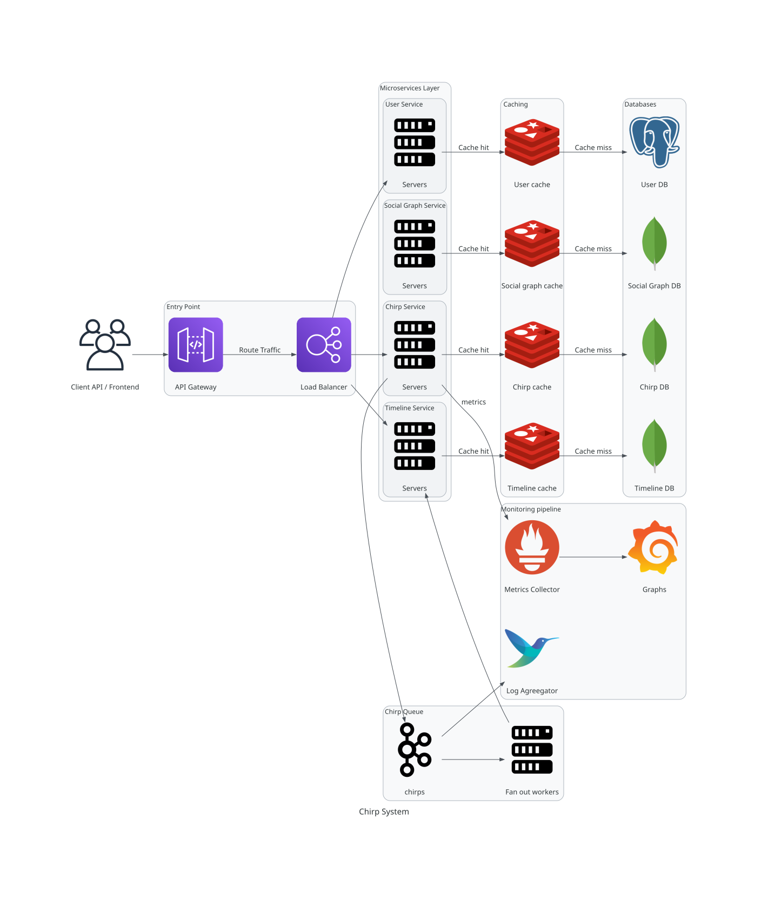

# Chirp System



Chirp is a distributed, microservices-based social networking platform (similar to Twitter/X) engineered for high concurrency, 
low-latency reads, and horizontal scalability. The platform allows users to register profiles, publish chirps, follow 
other users, and view dynamically updated personal feeds.

---

## Architecture Overview

The system architecture is organized into decoupled layers following modern distributed systems and microservices design principles:

```
[ Client Requests ]
        │
        ▼
┌────────────────────────────────────────────────────────┐
│                      Entry Point                       │
│      API Gateway  ──(Route traffic)──▶  Load Balancer  │
└──────────────────────────┬─────────────────────────────┘
                           │ Route
        ┌──────────────────┼──────────────────┬──────────────────┐
        ▼                  ▼                  ▼                  ▼
┌──────────────┐   ┌──────────────┐   ┌──────────────┐   ┌──────────────┐
│ Chirp Service│   │ User Service │   │Timeline Svc  │   │ Social Graph │
└───────┬──────┘   └──────┬───────┘   └──────▲───────┘   └──────┬───────┘
        │                 │                  │ Update feeds     │
        │ Publish         │                  │                  │
        ▼                 │            ┌─────┴────────┐         │
┌──────────────┐          │            │Fan-out Worker│         │
│ Apache Kafka ├──────────┼───────────▶└──────────────┘         │
└───────┬──────┘          │ Distribute chirps                   │
        │ Logs            │                                     │
        ▼                 │                                     │
┌──────────────┐          │                                     │
│Log Aggregator│          │                                     │
└──────────────┘          │                                     │
                          │ Cache-Aside Reads                   │
        ┌─────────────────┼──────────────────┬──────────────────┘
        ▼                 ▼                  ▼                  ▼
┌──────────────┐   ┌──────────────┐   ┌──────────────┐   ┌──────────────┐
│ Chirp Cache  │   │  User Cache  │   │Timeline Cache│   │ Social Cache │
└───────┬──────┘   └──────┬───────┘   └──────┬───────┘   └──────┬───────┘
        │ Cache Miss      │ Cache Miss       │ Cache Miss       │ Cache Miss
        ▼                 ▼                  ▼                  ▼
┌──────────────┐   ┌──────────────┐   ┌──────────────┐   ┌──────────────┐
│ Chirp Store  │   │  User Store  │   │Timeline Store│   │ Social Store │
│   (NoSQL)    │   │ (PostgreSQL) │   │   (NoSQL)    │   │   (NoSQL)    │
└──────────────┘   └──────────────┘   └──────────────┘   └──────────────┘
```

---

## Architectural Layers & Components

### 1. Entry Point
* **API Gateway**: Acts as the single entry door for external client traffic. Handles request routing, SSL termination, authentication/authorization verification, and rate limiting.
* **Load Balancer**: Distributes incoming client requests uniformly across service instances to ensure high availability and prevent single-point overload.

---

### 2. Microservices Layer
The core business capabilities are divided into dedicated microservices:

#### User Service (`user-svc`)
* **Responsibilities**: Manages user registration, profiles, authentication, credentials, and account metadata (first name, last name, bio, date of birth, email, password, etc.). Media uploads are planned for future iterations.
* **Communication**: REST API for frontend clients; gRPC for internal inter-service communication.
* **Data Flow**: Reads through **User Cache** using cache-aside; queries **User Store (PostgreSQL)** on cache misses. Sends operational telemetry to the **Metrics Collector**.
* **Source Code**: [chirp_user](https://github.com/prahlad-das/chirp_user)

#### Chirp Service (`chirp-svc`)
* **Responsibilities**: Handles chirp creation, validation, modification, retrieval, and deletion.
* **Communication**: REST API for client interactions; gRPC for internal service RPCs.
* **Data Flow**: 
  * Queries **Chirp Cache** with fallback to **Chirp Store (NoSQL)** on cache miss.
  * Emits published tweets to **Apache Kafka** for asynchronous processing.
  * Emits runtime metrics to the **Metrics Collector**.
* **Source Code**: *Pending*

#### Timeline Service (`timeline-svc`)
* **Responsibilities**: Generates and serves customized user timelines (Home feed and user activity timelines) with sub-second response times.
* **Communication**: REST API for client feed queries; gRPC for internal communication.
* **Data Flow**:
  * Feeds are pre-computed and kept up-to-date via updates pushed by **Fan-out Workers**.
  * Reads feed data from **Timeline Cache**, falling back to **Timeline Store (NoSQL)** on cache misses.
  * Sends telemetry to the **Metrics Collector**.
* **Source Code**: *Pending*

#### Social Graph Service (`social-svc`)
* **Responsibilities**: Maintains user social relationships (follow, unfollow, follower lists, and following lists).
* **Communication**: REST API for client follow actions; gRPC for internal queries from fan-out workers and other services.
* **Data Flow**:
  * Reads follower/following graphs from **Social Graph Cache**, backed by **Social Graph Store (NoSQL)**.
  * Sends operational metrics to the **Metrics Collector**.
* **Source Code**: *Pending*

---

### 3. Message Queue & Asynchronous Processing
* **Apache Kafka**: Serves as the distributed streaming backbone. Decouples the Chirp Service from downstream feed generation, buffering chirp events with high durability and throughput.
* **Fan-out Workers**: Consumer group that reads newly published chirps from Kafka, queries the **Social Graph Service** for followers, and updates the timeline cache/store of affected users (**Fan-out on Write / Push model**).

---

### 4. Caching Layer (Cache-Aside Pattern)
Each microservice has an isolated in-memory cache to guarantee low-latency read operations:
* **Chirp Cache**: Caches hot chirp documents and recent chirps.
* **User Cache**: Caches user profile records and session information.
* **Timeline Cache**: Holds pre-computed timeline feed references (e.g., chirp ID lists) for quick rendering.
* **Social Graph Cache**: Caches follower and following sets for fast graph lookups.

**Strategy**: **Cache-Aside (Lazy Loading)**
1. The service checks the respective cache for the requested entity.
2. If present (cache hit), the cached data is returned immediately.
3. If absent (cache miss), the data is read from the persistent NoSQL database, populated into the cache, and returned to the caller.

---

### 5. Persistent Storage Layer (NoSQL Databases)
Each domain service manages its own dedicated persistent database to maintain bounded contexts and enable independent scaling:
* **User Store**: Document / Key-Value PostgreSQL database storing user account details, credentials, and profiles.
* **Chirp Store**: Document / Wide-column NoSQL database storing chirp contents, author references, timestamps, and metadata.
* **Timeline Store**: Persistent store archiving user timeline mappings and historical feed entries.
* **Social Graph Store**: Graph or adjacency-list NoSQL database storing follow/follower edges.

---

### 6. Observability & Monitoring Pipeline
* **Metrics Collector**: Ingests health checks, request rates, error counts, and latency percentiles emitted across all microservice servers (`user-svc`, `chirp-svc`, `timeline-svc`, `social-svc`).
* **Log Aggregator**: Centralized logging system collecting and indexing broker and pipeline logs from **Kafka** and server components for real-time diagnostics and auditing.

---

## Data Flow & Request Lifecycles

### 1. Chirp Creation & Timeline Fan-out
1. **Client** issues a `POST /chirp` request through the **API Gateway** and **Load Balancer** to the **Chirp Service**.
2. **Chirp Service** validates the payload, writes the new chirp to **Chirp Store** and **Chirp Cache**.
3. **Chirp Service** publishes a `ChirpCreated` event to **Kafka** ("Publish chirps").
4. **Fan-out Workers** consume the event from **Kafka** ("Distribute chirps").
5. Workers fetch follower lists from the **Social Graph Service** / **Social Graph Cache**.
6. Workers update the feeds in the **Timeline Service** / **Timeline Cache** for all followers ("Update feeds").

### 2. Timeline Fetching
1. **Client** requests their home feed via the **API Gateway** and **Load Balancer**.
2. **Timeline Service** checks the **Timeline Cache** ("Cache aside read").
3. On cache miss, it queries **Timeline Store**, populates the cache, and hydrates chirp details via **Chirps Cache** / **Chirp Service**.
4. The synthesized timeline is returned to the client.

### 3. Follower Relationship Update
1. **Client** triggers a follow action via **API Gateway** and **Load Balancer** directed to **Social Graph Service**.
2. **Social Graph Service** updates the **Social Graph Store** and refreshes the **Social Graph Cache**.
